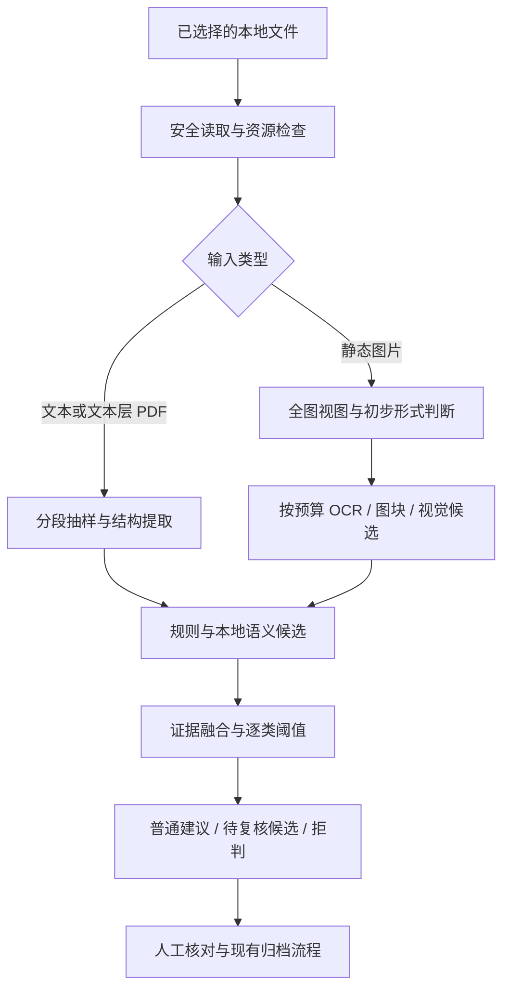

# NeatDrop 离线分类能力提升策划案

版本：v1.0 · 2026-11-03  
状态：策划稿，供范围与验收评审；本文件不代表相关能力已开发或模型效果已验证。  
适用项目：`E:\项目总和\kaggle\neatdrop`  
承接设计：[现有离线分类设计](2026-11-02-offline-classification-design.md)

## 一、项目目标与推荐决策

提升离线模式处理日常资料时的准确性、覆盖面和可解释性，尤其解决“没有固定标题就认不出来”“截图文字读不全”“能看出是文档，却无法判断用途”等问题。评价重点是用户需要纠正多少建议，以及有多少资料能得到有用建议。

**推荐建设“多证据离线分类引擎”：保留结构化规则，补充本地语义理解，按内容形式分流图片，再通过经评测校准的决策层给出分类。** 首期以 CPU 可运行、无需常驻大模型为约束，先完善评测和提取，再决定具体模型与启用范围。

建设顺序：

1. 建立有授权、有标注规范的评测集，保存当前版本基线。
2. 改进文本抽样、OCR 版面保留和长图读取，减少输入信息丢失。
3. 评测小型中文/多语言语义模型，补足固定词规则的召回缺口。
4. 统一规则、语义、视觉证据的决策，支持只确定主分类、展示候选和明确拒判。
5. 完成真实断网、现有整理流程和资源消耗验收，再发布经过验证的能力范围。

首期交付不以“必须换成某个模型”为目标。新模型达不到质量、速度或部署条件时，不纳入默认引擎；已经验证有效的提取和规则改进可以独立交付。

## 二、现状与问题依据

以下事实来自当前源码检查，以及前期对少量构造文本的实际规则调用。构造样例说明具体缺口，不代表用户资料总体准确率。

| 当前实现 | 对使用体验的影响 | 本轮处理方向 |
| --- | --- | --- |
| `classifier.py` 有 28 条规则，标题锚点权重较高 | 内容符合论文、笔记特征，但缺少固定词时容易没有候选 | 结构特征与语义候选共同判断 |
| 分类表已有 9 个主分类、35 个子分类；其中包含“待分类”“照片待细分”等兜底项 | 目录有定义不等于引擎有充分识别能力 | 建立逐类能力表，区分普通建议、候选支持和暂不支持 |
| 视觉模型只有 10 个场景标签 | 文档、截图只能判形式，无法覆盖全部归档用途；壁纸没有直接视觉候选 | 分离形式判断与用途判断，完善按用途的候选定义 |
| 图片 OCR 最长边缩至 1600px，最多保留 150 行，丢弃坐标 | 长截图小字和标题层级容易丢失，全文拼接可能混淆多个区域 | 保留位置，按预算读取图块并标示未覆盖区域 |
| CLIP 使用英文提示词，图像中心裁切至 224×224 | 中文场景和边缘内容可能识别不充分 | 先修正视图取样，再评估中文视觉模型 |
| 文本只取前 12000 字符；PDF 读取前两页和末页后再截断 | 重要信息可能在中部，末页信息也可能被总长度截断排除 | 保持总预算，改用分段配额抽样 |
| 规则分数、OCR 分数与视觉相似度分别使用固定条件 | 不能直接比较，也没有代表性数据支撑阈值 | 统一保留原始证据，单独校准决策条件 |
| 已有功能、安全和少量真实推理测试 | 能证明流程可运行，不能证明普遍分类质量 | 增加冻结评测集和版本对照报告 |

已观察到的差异：一段具有 Abstract、Keywords、Methods、References 的英文研究文本，以及没有“课程笔记”标题的矩阵定义/定理文本，都进入待分类；加上“线性代数课程笔记”标题后，后者能归入课程笔记。这支持优先解决表达变化和内容结构识别的问题。

现有系统已经具备内容形式与归档用途分离、主分类单独归档、候选证据和人工确认等基础。本方案是在这些能力上完善识别，不重新建设文件整理系统。

## 三、范围与约束

### 3.1 首期范围

- 保持当前 JPG/JPEG/PNG/WebP 静态图片、UTF-8 TXT/Markdown、有文本层 PDF 的支持边界。
- 优先改善学习科研、票据凭证、工作办公、生活服务和常见截图；照片/设计素材同时评测，不能默认视为已覆盖。
- 保持现有分类 ID、固定目录和撤回记录兼容；允许在现有主分类下暂不指定子分类。
- 增加候选选择、证据来源、取样范围和能力降级说明，延续“选择 → 分析 → 复核 → 结果”的工作流。
- 为模型包增加明确的版本、完整性和本地自检状态。

### 3.2 后续独立立项

扫描 PDF OCR、DOCX/PPTX、更多编码和图片格式、用户自定义目录体系、个性化分类器，以及本地生成式语言/视觉大模型，分别在首期评测结果基础上决定。首期不把扩大文件格式支持与分类质量提升捆绑。

### 3.3 必须继承的约束

1. 原件始终保留；分类只提供建议。归档副本仍需人工确认和固定计划，撤回仍依赖可信凭据与文件身份。
2. 离线推理不联网、不下载、不回传统计或文件内容；能力不足不自动调用云端。
3. 模型准备是单独、主动触发的操作。支持从预先准备的本地模型包安装，并核对来源、许可、固定版本与可信摘要。
4. 云端仍使用现有独立授权和抽样边界，不把本地 OCR、向量、版面或评测样本加入云端请求。
5. 不读取人脸身份、GPS 或 EXIF 身份信息，不把二维码/链接当成可自动访问的地址。
6. 保持单文件 20 MiB、单批 50 项/200 MiB、图片 2400 万像素及最长边 16000px 的现有限制。PDF 仍受独立进程、12 秒与 384 MiB 解析预算约束。
7. 不持久化真实资料草稿或向量，不从用户修改中默认收集训练数据。真实样本加入评测集必须另有明确授权。

## 四、技术路线比较

| 路线 | 优点 | 主要限制 | 决策 |
| --- | --- | --- | --- |
| A：规则与 OCR 增强 | 包体小、解释直接、上线较快；适合格式明确的票据与通知 | 规则维护随表达变化增长，难以全面覆盖无固定标题内容 | 作为第一阶段与缺模型时的降级路径 |
| B：规则＋本地语义＋图片分流 | 兼顾结构识别与表达泛化，可复用现有 ONNX Runtime 和工作流 | 需要评测、阈值校准和模型包管理；嵌入相似度不能直接当分类概率 | **首期推荐** |
| C：本地生成式语言/视觉模型 | 有机会理解复杂布局、跨段语义和混合内容 | 硬件、包体、耗时与输出稳定性尚未验证，仍可能臆测 | 后续限范围试验，不作为首期依赖 |

首期不叠加多个常驻语义模型。对候选模型做离线对照后选一个默认包，避免为了语言覆盖同时加载多套模型而缺少收益证据。

## 五、分类引擎设计

### 5.1 统一处理链

形式判断只用于安排识别资源，不能独占后续路径。例如先判为照片但含有大量文字的图片，仍可进入 OCR；初判不确定时执行受预算约束的两条路径，避免错误分流导致整份资料失去识别机会。

### 5.2 先明确“形式”和“用途”

保留当前六类内容形式与九个归档主分类。截图是形式，支付凭证是用途；人物、风景与海报外观也不能单独证明用户希望如何归档。

决策遵循以下次序：

- 有足够主分类证据，但子分类不明确：返回主分类，子分类为空，提示“主分类已有依据，二级分类待确认”。初版必须逐项复核。
- 多个用途都成立：保留一个待确认的主建议和最多三个候选，不用多个目标目录同时归档。
- 仅能识别形式：保留形式信息，归档用途待分类。
- 证据不足、矛盾或不属于当前分类表：明确拒判，不选择“最接近”的类别充当确定答案。

“壁纸”“临时资料”“工作记录”等具有较强个人用途属性的类别，不能仅凭尺寸、视觉风格或内容时效性给出普通建议。需要明确文本证据或人工选择。

### 5.3 分类知识表

为每个有实际含义的子分类维护可版本化的定义，包含：适用范围、明确正例、容易混淆的反例、必要结构字段、父分类和易混候选。兜底项单独标记，不当作与论文、合同等同等的语义类别参与竞争。

示例：“论文文献”应涵盖没有“论文”字样的学术标题、摘要、方法和参考文献结构；同时排除论文写作教程、参考文献格式说明和只有一条引用的普通笔记。“发票”要求票据主体与字段组合，排除发票识别教程和报销提交说明。

规则与语义可以共享定义，但要分别保留判断来源。多个来自同一段文本的特征不视为互相独立的证明，不能因“规则和语义都命中”就直接宣称高置信。

### 5.4 文本与 PDF 提取

- TXT/Markdown 保持最多 12000 个本地抽样字符，改为头、中、尾各最多 4000 字符；短文去重，未用配额可分配给其他段。
- PDF 优先读取第 1、2 页、中间页与末页，去重后总计最多四页、12000 字符；按页分配字符额度，避免前页挤掉末页。解析不遍历全文，仍须在原解析预算内完成。
- 保留抽样段位置、页码、截断和覆盖不足标志。Markdown 标题、段落结构和 PDF 可获得的文本结构作为证据；页眉不自动当作标题。
- 语义输入按所选模型的真实分词上限分块。试验起点为每块不超过 384 token、相邻块最多重叠 48 token、每文件最多六块，选取时覆盖头中尾。该参数须随模型和资源评测定版。
- 多块分数保留分布和冲突，不能仅用最高块决定整份文件。正文出现一段示例发票，不应使整份课程资料成为发票。

模型无法看到的部分必须可追溯。抽样充分性不足时，不因可见片段分数高就消除复核标记。

### 5.5 图片、OCR 与长图

先保持一张等比例全图视图，避免所有判断依赖中心裁切。对于长宽比明显偏大、缩小后文字过小或版面复杂的图片，在原像素边界内增加图块。

建议试验参数：最长边 OCR 基础视图 1600px；最多追加五个有重叠的图块，覆盖首尾并分散读取中部；单图最多六次 OCR。图块配额不足以覆盖全图时，明确标记局部读取，不能显示“全文已识别”。最终触发条件与图块尺寸由质量/耗时对照确定。

OCR 输出保留文本框坐标、识别分数、图块来源和阅读顺序；坐标统一映射回原图。对重叠区域去重，利用位置辅助区分标题、字段表格、正文和边缘水印。OCR 分数只反映局部文字识别，不作为用途分类概率。

票据、订单、医疗报告等以结构化 OCR 和语义为主；照片以视觉场景为主，文字作补充；海报、插画、表情包综合两者。手写板书、低清照片和多份文件拼图在首期允许只给候选或拒判。

### 5.6 本地语义模型

通过文档分块与分类定义/正反例的向量比较生成候选，再交给决策层。它用于改善“不同表达指向相似用途”，不生成目录、命令或文件操作。

| 候选 | 评测角色 | 采用前必须验证 |
| --- | --- | --- |
| `BAAI/bge-small-zh-v1.5` | 中文资料优先的小型语义候选 | 中英文混合质量、ONNX CPU 兼容、分词和池化一致性、许可 |
| `intfloat/multilingual-e5-small` | 多语言对照候选，重点观察英文论文和混合文本 | 按模型卡正确使用前缀/池化；短分类描述与长文分块的表现 |
| `BAAI/bge-m3` | 后续资源允许时的质量对照 | 首期不默认打包；更大的资源消耗必须带来可测收益 |

检索模型的通用榜单成绩不能代替 NeatDrop 分类评测。量化模型与原模型也必须做输出和任务指标对照。运行时只依赖已验证的本地推理包，不安装会在首次调用时自动获取权重的远程 pipeline。

### 5.7 视觉模型策略

保留现有 CLIP 作为可复现基线，先比较“中心裁切”与“全图＋有限局部视图”，再决定是否更换权重。增加更贴近用途的多提示候选与反例，但不要求通用视觉模型直接理解所有 35 个子分类。

Chinese-CLIP 可以进入受控对照。其官方 ONNX 部署材料不能证明本机 CPU 的速度、内存和质量；只有在同样样本、同样资源预算下取得收益才作为可选包。首期允许保持现有视觉模型并对困难图片继续要求复核。

### 5.8 证据融合与拒判

不直接相加规则权重、OCR 分数和视觉相似度。先保留各引擎候选、结构字段、取样质量、语言、缺失能力和冲突，再使用明确、可测试的决策策略。

初版采用按类别配置的阈值与阻断条件：在校准集上选择语义相似度阈值、前两候选间隔、主分类聚合条件和结构门槛；数据不足的类别只开放候选，不开放普通建议。不训练复杂融合网络。

| 输出状态 | 条件 | 界面与确认规则 |
| --- | --- | --- |
| 普通建议 | 该类别已通过发布验证，当前证据达到其门槛，无冲突、取样不足或必要引擎失效 | 展示用途及关键依据；仍须按现有流程人工确认，可参加普通建议批量确认 |
| 待复核候选 | 有有用线索，但子类不清楚、候选接近、信息不完整或类别尚未充分评测 | 展示最多三个候选与原因，逐项确认 |
| 拒判 | 没有足够候选、超出分类范围、严重冲突或关键处理失败 | 保留可获得的形式信息及原名称，归入待分类，逐项确认或跳过 |

票据、证件、医疗等类别使用更严格的结构与用途证据；“发票教程”“证件示例”“医疗课程讲义”等必须进入反例回归。单凭文件名不产生普通建议。

新引擎不显示虚构的“98% 准确率”。若将来要展示概率，需单独验证概率校准；首期只显示状态、依据、候选和不确定原因。

## 六、用户体验与接口衔接

沿用森林绿工作台，不进行整体视觉改版。详情面板重点回答：建议放在哪里、依据是什么、还有哪些可能、为什么需要我核对。

示例文案：

> 建议归档：学习科研 / 论文文献  
> 依据：存在摘要、研究方法与参考文献结构；正文与论文用途定义相符。  
> 读取范围：第 1、2、8、16 页的本地抽样。  
> 待核对：本文件未完整读取，请确认归档用途。

前端新增候选快捷选择。选择候选等同编辑分类，会使该项旧确认与已有计划失效；不能直接代表用户完成确认。主类确定、子类为空时保留现有“仅按主分类归档”能力。

分析状态补充本地能力信息：未安装、校验中、就绪、自检失败、预算受限。不能仅因为模型文件存在就标为就绪。硬件检查只需本地 CPU/可用内存和一次合成输入基准，不采集设备标识或上传。

建议接口增量（需在工程实施计划中定版）：

| 字段/状态 | 用途与兼容方式 |
| --- | --- |
| `decision_level` | `ordinary`、`candidate`、`abstain`；现有 `review_required` 继续作为前后端确认门槛，后二者必须为 true |
| `category` / `subcategory` | 沿用既有 ID；子类允许为空，前后端类型同步；不得输出分类表外值 |
| `candidates` | 最多三个分类候选与简短依据；相似度保留为引擎指标，不表示百分比 |
| `evidence_items` | 保留既有来源，增补语义/结构来源和可选页码、区域位置；旧消费者可忽略新增字段 |
| `sampling` | 抽样页/段/区域、是否截断、预算是否耗尽，供界面解释信息覆盖范围 |
| `engine_versions` | 规则、知识表、模型包、阈值配置版本，便于复现和回滚 |

普通工作流的内容、OCR 框和向量仅在会话内存中使用；不写入操作日志、浏览器存储或持久性能记录。现有事务日志继续只承担文件操作审计。

## 七、评测与验收方案

### 7.1 样本来源与标注

第一轮收集约 300–500 份样本，按 400 份规划。优先采用人工合成、许可清楚的公开资料及用户明确授权的脱敏本地样本，不默认扫描整台电脑。真实资料经授权复制到专用评测目录；原件不改动。评测目录本身视为可能含隐私的本地资料，不提交仓库，不自动上传。

标注至少记录：匿名样本 ID、来源与授权说明、内容形式、可接受的主/子分类集合、用途是否歧义、可否成为普通建议、困难因素、近重复组 ID。目录路径不作为分类输入。原图中已经可见的内容与文件名应按真实部署场景保留或有记录地脱敏。

建议约 70% 为常见、可判断的资料，约 30% 为困难/混合/范围外资料；按实际用途分布报告结果，同时提供按类别平衡的诊断结果。不要为了凑数量平均填满所有子类。

必须覆盖：

- 无固定用途标题的中英文论文、数学笔记、课件和研究报告。
- 发票与报销说明、合同与合同范本、简历与招聘海报等易混组合。
- 支付/订单/快递/取餐截图、长截图、小字、旋转、低清、边缘标题和水印。
- 自然照片中的零星文字、海报中的照片、多张资料拼图、手写板书。
- 文件名误导、空白、随机文本、分类表外内容、无法合理确定个人用途的资料。

主观用途样本允许多个可接受标签；难以达成一致的样本标为必须复核，不强行选一个标签当真值。规则中的明确触发短语不能成为唯一的测试样本来源。

### 7.2 划分和冻结

按近重复组、同模板、同文档来源分组划分，禁止同一文档的截图、裁切或改名版本分散到不同集合。初始约 60% 开发、20% 校准、20% 冻结测试，分组优先，数量可略有偏差。

开发集用于规则和类别定义调整；校准集用于阈值和模型选择；冻结测试集仅用于最终对照。任何根据测试错误进行调整的轮次，都应把该集合视为已使用数据，并以新冻结样本作独立验证。

400 份样本约只有 80 份冻结测试，无法充分证明 35 个子类质量。第一轮主要完成路线筛选和错误定位。若要发布带统计支撑的质量结论，需要继续补充独立测试数据，不能复用训练/调参样本凑数量。

### 7.3 指标定义

| 指标 | 定义与作用 |
| --- | --- |
| 主分类/二级分类 Top-1 | 对有明确真值的样本，检查最终首选分类；只主类正确不算子类正确；同时报告拒判数量 |
| 每类 Precision / Recall、宏平均 F1 | 防止常见类别掩盖小类问题；附每类样本量与混淆矩阵 |
| 普通建议错误率 | 错误普通建议数 / 全部普通建议数；对真值要求复核却给普通建议也记为错误 |
| 普通建议覆盖率 | 普通建议数 / 本批有效评测文件数；另报明确可分类子集覆盖率 |
| 复核率与拒判率 | 必须分别报告；拒判属于需要复核的子集，不能重复相加 |
| Top-3 命中率 | 正确用途是否进入候选；以全部明确可分类样本为分母，没候选的样本算未命中 |
| 处理成功率 | 在支持范围内完成分析的比例；超时和引擎失败单列，不能从分母静默移除 |
| 资源指标 | 冷启动时间、热运行 P50/P95、峰值进程树内存、模型包大小；按文本/普通图片/长图分别统计 |

在相同数据上比较当前基线、提取改进、语义增强、融合决策四组结果；必要时追加视觉模型对照。同覆盖率比较错误率、同错误率比较覆盖率，不能仅凭“把更多文件变成待复核”声称准确性提升。

### 7.4 分层验收目标

以下为建议的产品门槛，不是已测结果，也不是上线准确率承诺。

**第一轮可行性验收：**

- 基线、样本清单、划分、全部配置和错误分析可复现，报告不隐去失败项。
- 预先定义的无固定标题文本子集上，Top-3 命中率相对基线提升至少 15 个百分点；基线已达 90% 时，改为达到 95% 或以上且无明显退化。小样本必须附命中数，不能只报比例。
- 在匹配普通建议覆盖率的比较中，普通建议错误数不增加；目标是减少用户纠正次数。样本不足时结论标为探索性。
- 发票教程、报销说明、自然照片零星文字等关键反例不出现新增的错误普通建议。
- 无收益的模型不进入默认包；如果整体收益不成立，交付评测结论及独立有效的提取改进。
- 

**面向日常使用的发布门槛：**

- 在新增、独立冻结的测试集上，已验证支持范围的普通建议覆盖率目标不低于 50%；全部样本覆盖率同时披露。
- 普通建议错误率的 95% Wilson 区间上界不高于 3%。需要足够普通建议样本；零错误时约需 125 个独立样本，实际以区间计算为准，不把近重复文件视为独立证据。
- 按预计 50% 覆盖率规划，建议把冻结测试扩充到约 400 个独立样本，为整体普通建议指标留出统计余量。该规模仍不证明每个子类均达标。
- 每类必须披露支持量。证据不足的类别维持候选/复核，不以整体指标替其背书；高风险类别另查结构门槛和全部错误。
- 原件保护、确认门槛、云端授权隔离与可信撤回回归全部通过。

### 7.5 性能目标与资源边界

目前尚未确认部署机器 CPU、可用内存与模型实测表现，因此以下仅为 CPU 模式的初始设计目标：热运行文本 P95 ≤ 2 秒、普通图片 P95 ≤ 8 秒、长图 P95 ≤ 20 秒，新增推理峰值内存目标 ≤ 1.5 GiB。必须在报告中记录实际机器与输入规模。

以单个推理任务运行、限制线程数和图块数起步；不并行加载全部模型。初始化与热运行分别计时，取消后不启动后续分块。对无法中断的原生推理，采用受控工作进程、超时终止及资源限额，不能仅靠界面取消按钮承诺停止计算。

在工程计划中依据本机预检确定工作进程硬预算；PDF 解析限额保持原值。预算无法满足时降级为已验证的规则/OCR能力或待复核，并展示原因。不得以超时重试循环或放宽现有文件安全限制换取指标。

## 八、实施分期与交付物

按一个开发工作流估算，首期工程工作约 9–15 个工作日；样本收集、授权、标注复核与额外发布测试数据准备单独计算，不承诺随工程工作同步完成。模型下载与可用导出产物也可能影响周期。

| 阶段 | 预计工程工作量 | 主要交付物 | 进入下一阶段的条件 |
| --- | --- | --- | --- |
| P0 评测基线 | 1–2 天 | 标注规范、逐类能力表、分组数据清单、基线脚本与报告模板 | 样本权属清楚；冻结划分；能复现现有错误 |
| P1 提取与版面 | 2–3 天 | 文本/PDF 分段抽样、OCR 坐标与去重、长图有限图块、覆盖不足说明 | 提取质量有可测收益；预算和错误边界测试通过 |
| P2 语义候选 | 3–5 天 | 类别知识表、小型模型对照、选定模型包、断网推理适配与完整性校验 | 在校准集有收益；CPU与包体可接受；缺模型可降级 |
| P3 融合与界面 | 2–3 天 | 分层决策、候选选择、解释、版本和能力状态 | 决策与人工确认一致；旧计划失效规则和兼容测试通过 |
| P4 发布验证 | 1–2 天 | 冻结对照、断网实测、性能报告、操作指南及回滚记录 | 对拟发布范围达到相应门槛；不足类别保留复核 |

P0 的代表性数据不足时，先用许可清楚的公开/合成样本完成工具链，真实用途收益保持未验证。P2 可以提前做合成输入的兼容性试验，但不能先宣称分类有效。

## 九、代码改动落点

以下为职责映射，不是逐行开发指令；具体接口和测试用例将在工程实施计划中细化。

| 现有/建议路径 | 职责 |
| --- | --- |
| `backend/neatdrop/analysis.py`、`parsing.py` | 保持安全读取；接入分段取样、引擎调度、增量状态与取消 |
| `backend/neatdrop/offline.py` | 保留兼容入口；分离 OCR/视觉调用、模型状态和资源控制，避免继续集中全部逻辑 |
| `backend/neatdrop/classifier.py` | 保留现有规则作为基线；把候选生成与最终决策分开 |
| 建议新增 `backend/neatdrop/extraction.py` | 抽样段、OCR 区域、来源坐标与覆盖状态 |
| 建议新增 `backend/neatdrop/semantic.py` | 本地模型加载、分块向量与类别候选，不接触文件执行 |
| 建议新增 `backend/neatdrop/decision.py` | 主/子类融合、逐类阈值、冲突和拒判条件 |
| 建议新增 `backend/neatdrop/classification_profiles.json` | 分类定义、正反例、模型输入模板、决策配置版本 |
| `backend/neatdrop/taxonomy.py` | 继续作为类别 ID 和目录映射唯一权威；知识表必须通过一致性校验 |
| `scripts/prepare_offline.py`、项目内 `models/` | 显式模型准备与本地导入；可信摘要、许可、依赖及原子切换 |
| 建议新增 `scripts/evaluate_offline.py`、`docs/evaluation/` | 分组校验、基线/新版报告、混淆和性能指标；不包含真实样本内容 |
| `frontend/src/types.ts`、`useWorkspace.ts`、`components/Inspector.tsx` | 兼容新增字段、候选编辑、证据与能力状态、确认失效 |
| 后端/前端现有测试目录 | 增加分类质量回归、预算、断网、降级与工作流测试 |

评测样本的默认位置可设为项目 `.cache/offline-evaluation/`，由操作者显式提供清单。真实文件与完整 OCR 只留在该授权目录；可分享报告默认仅含匿名 ID、标签、计数与耗时。公开示例另放小规模合成夹具。

## 十、测试、风险与回退

### 10.1 验证组合

1. **确定性回归：** 类别表一致性、正反例、同分/冲突、主类确定子类未知、抽样去重、预算耗尽、候选编辑使确认/计划失效。
2. **真实引擎验证：** 授权夹具上实际 OCR 与语义推理；分开记录准备阶段与运行阶段。阻断进程外网并监测出站请求，不能只用模拟模型证明断网可用。
3. **异常与部署：** 模型缺失/摘要不符/自检失败、tokenizer 不匹配、长图超预算、超时、内存不足、中途取消、重启和升级回退。
4. **完整工作流：** 离线分析、普通/候选/拒判、人工修改、生成副本、可信撤回；原件摘要不变；后台进度与断线恢复不重复发起执行。
5. **前端和回归：** 运行当时完整后端/前端测试及生产构建；检查桌面与手机候选展示、焦点与键盘操作。历史测试计数不当作新版本验收结果。

### 10.2 主要风险

| 风险 | 应对 |
| --- | --- |
| 样本偏向某种模板，指标看似提升 | 分组隔离、公开数据分布、补充反例；独立测试验证 |
| 模型认为语义相近就等于归档用途相同 | 用途反例、必要字段和拒判；主观用途逐项复核 |
| 图块/OCR 变多导致卡顿 | 固定次数、进程预算、增量状态；承认未读全，不无限追加 |
| 量化、导出或模型来源不可靠 | 核查许可与固定版本；可信摘要；导出一致性与任务对照 |
| 更换模型使旧阈值失效 | 模型、知识表和阈值成套版本；不兼容时禁用普通建议 |
| 未授权持久化用户内容 | 默认内存处理；评测采样单独授权；报告不含正文/绝对路径 |
| 新引擎覆盖不全却给全能宣传 | 发布逐类能力表，明确普通建议/候选/未验证范围 |

回退以引擎包为单位：保存上一套模型、规则、知识表和阈值配置，原子切换生效，已经开始的分析使用原版本快照。模型更换不改变正在执行的文件计划；对结果重新分析才按现有机制使旧确认和旧计划失效。历史事务继续按原始路径与可信凭据查询、撤回。

## 十一、首期完成标准

- 有一份可复现的当前版本与新版分类对照报告，明确改善、退化、样本量和未验证范围。
- 至少在无固定标题文本或长截图等目标难点上取得可测收益，并解释收益来自提取、模型还是决策。
- 所有结果能说明本地依据、读取范围和不确定性；支持主类已知、子类待确认与真正拒判。
- 正常分析不访问外网，模型缺失时不静默下载或上云，资源超限时有明确结果。
- 整理、确认、复制、日志和可信撤回机制保持有效，原件保护回归通过。
- 准确率宣传仅限独立数据实际支持的范围；达不到发布门槛的能力只以候选/复核方式提供。

完成策划后的下一项工程产物，是基于本文件的逐任务实施计划与 P0 评测清单。当前交付止于策划案，未安装新模型、未建立真实资料评测集、未改动分类运行逻辑。

## 十二、参考资料与证据边界

- 当前实现：项目内 `backend/neatdrop/classifier.py`、`offline.py`、`parsing.py`、`analysis.py`、`taxonomy.py` 与 `backend/tests/test_classification.py`。
- [BGE small 中文模型卡](https://huggingface.co/BAAI/bge-small-zh-v1.5)：候选模型资料，采用时需核对固定修订版和许可。
- [Multilingual E5 small 模型卡](https://huggingface.co/intfloat/multilingual-e5-small)：输入前缀、池化与长度限制应遵守模型卡；通用评测不等于本项目分类效果。
- [BGE-M3 官方说明](https://bge-model.com/bge/bge_m3.html)：仅作后续候选参考，首期不依赖其资源表现。
- [Chinese-CLIP 项目](https://github.com/OFA-Sys/Chinese-CLIP)与[官方部署说明](https://github.com/OFA-Sys/Chinese-CLIP/blob/master/deployment_En.md)：有 ONNX 部署路线，已公开的 GPU 数据不作为本机 CPU 性能承诺。

以上模型均未在本轮策划中下载或进行 NeatDrop 数据对照测试。具体采用哪个模型，由 P0–P2 的质量、许可、部署和资源评测共同决定。
