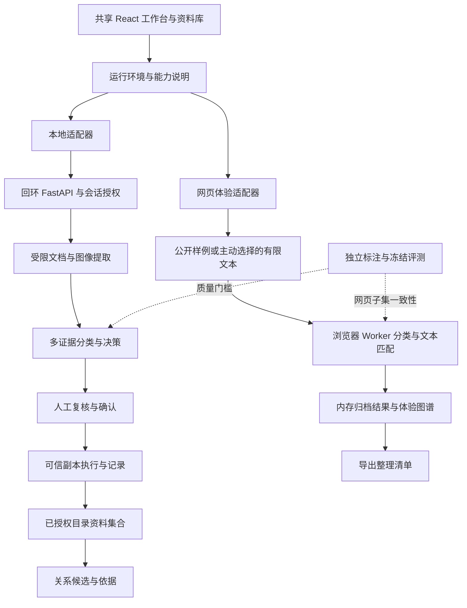
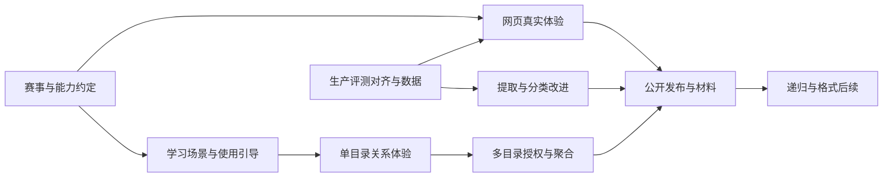

# NeatDrop 综合优化与参赛交付方案

日期：2026-11-10（Asia/Shanghai）

项目基线：`ef33729b3c385d552cc724c6e87bd8ca583261cb`，分支 `feat/obsidian-graph-v14`。

状态：供确认的综合设计方案。本文件描述目标和验收要求，不表示功能已经实现、质量指标已经达到或网站已经发布。

## 1. 方案目标与依据

产品定位：**面向学生与科研人员的本地优先资料整理工具，把课件、论文、笔记、实验资料与图片整理成有分类依据、可人工复核、可追溯、可探索关系的资料库。**

解决六类问题：

1. 评委不能直接通过公开链接体验现有本地应用。
2. 离线分类缺少独立质量证据，图片与部分文档提取仍有缺口。
3. 分类、证据、待复核与人工确认的含义不够清楚。
4. 知识图谱以单目录归档记录为范围，空图和跨目录使用价值不足。
5. 新手操作链较长，目录、模型状态、保存位置和异常恢复容易误解。
6. Qoder 开发证据、公开部署、作品帖与发布验收尚未形成交付闭环。

依据分为三种，不能相互替代：

- **用户提供的赛事截图**：StudyHack 与 LifeHack 两个赛道；通过 Qoder Sites 提供公开访问作品链接；在天池赛题论坛发布作品帖；介绍包含自我介绍、作品是什么、为什么做、五步以内怎么用、Qoder 制作过程。
- **当前源码与项目文档**：本地限制、能力、已完成工作和已知缺口。
- **本方案提出的选择与指标**：工程建议，等待实施与验收，不属于主办方要求。

报名资格、截止时间、既有项目与多工具协作边界、纯预置演示能否作为参赛作品，均须在正式提交前依据当届官方公告或运营答复确认。本方案不把上一轮口头分析中的日期与推断作为已核验规则，不代替用户报名、认证或发帖。

### 1.1 已完成的资产继续沿用

- 蓝色玻璃导航、白色工作区、现有五个目的地与 `MASTER.md`。
- 离线与在线模型设置分区，固定关闭按钮与独立滚动正文。
- 文件预览侧栏、资料库、复制计划、操作记录、可信撤回。
- OCR、CLIP、可选 BGE、固定分类表、读取位置、质量提示、候选与拒判。
- 图谱的分类色、清晰节点、曲线、2D/3D、拖动、缩放、键盘与列表入口。

最近一次已执行的前端验证为 35 个文件、332 项测试与生产构建通过。此事实说明当时的软件回归状态，不能用于证明分类准确率；本轮只制定方案，没有重新运行代码验收。

## 2. 当前问题清单

| 编号 | 现状与证据 | 影响 | 对应工作包 |
| --- | --- | --- | --- |
| I01 | `api.ts` 请求本地 API，`security.py` 限制回环客户端与 Host | 只上传静态页面不能运行主流程 | A、B |
| I02 | 执行、撤回与密钥保护依赖 Windows | 不能通过取消安全限制把原服务搬上公网 | B、G |
| I03 | `classifier.py` 以规则、结构与字段组合为主，BGE 候选尚未证明额外收益 | 无标题、口语化、跨学科表达容易漏分；换大模型不等于解决 | C、D |
| I04 | 只有合成开发集；`evaluate_offline.py` 的文件白名单缺少 DOCX/PPTX/XLSX/CSV | 无法对当前全部已支持格式作一致的发布评测 | C |
| I05 | 现有评测直接组合分类和决策，未完整复用生产质量处理链 | 评测结果可能不同于工作台实际输出 | C |
| I06 | 扫描 PDF、Office 内嵌图片不支持；复杂图表、公式和低清图仍有限 | 未读到内容时，分类器无法恢复缺失信息 | D |
| I07 | `approveSelected` 包括待复核候选；`approveOrdinary` 已有独立入口 | 用户可能把“全部确认”理解为“系统判定可靠” | E |
| I08 | `GraphService` 和 `GraphStore` 按目录建立，页面只有当前 workspace | 全局图谱不等于全部已登记资料；跨目录探索缺失 | F |
| I09 | 关联分析是独立操作，尚未分析与分析后无关系都可能呈现孤立节点 | 用户难以理解为什么只有圆点没有线 | E、F |
| I10 | 教程以收据为主，初次体验要理解多个阶段 | 学习科研价值不够集中 | E |
| I11 | 目录当前只扫描直接子项；原生选择器依赖系统 | 子目录、选择取消、权限失败容易被当作“文件无法加入” | E、H |
| I12 | README 与历史报告中含旧图谱描述、测试数字和功能边界 | 展示材料、帮助与实际行为可能不一致 | A、G |

现有未跟踪草案 `2026-11-10-neatdrop-web-demo-design.md` 可作为网页体验版参考。它写有“已否决上传”等决策文字，但本方案不据此视为用户已授权或已否决；不修改该草案。进入实施时先统一有效规格，避免同时维护两份矛盾的方案。

## 3. 路线选择

| 路线 | 优点 | 代价与问题 | 结论 |
| --- | --- | --- | --- |
| 只完善本地应用 | 最少改动，真实文件能力最完整 | 无法解决评委公开访问要求 | 保留为核心产品，不能独立完成参赛交付 |
| 改造为完整云端文件平台 | 公网可直接上传处理 | 需要租户隔离、存储、队列、清理、费用及新的授权模型，现有执行器不能照搬 | 本轮不采用 |
| **本地完整版 + 受限公开网页体验版，共用界面与协议** | 保留本地能力，能公开体验，信任边界明确 | 需要网页运行适配器与能力标识，两种运行方式必须说清楚 | **推荐** |

网页体验版应有可验证的真实计算能力，不能把预写分类与虚假进度条作为核心成果。建议以小型学习资料集为主，支持浏览器中对文本进行真实分类与关系计算；图片的本地处理结果明确标为预先在本地计算的记录。正式参赛形态仍以主办方接受为前提。

## 4. 总体架构与不可破坏的约束



### 4.1 区分运行环境和分析模式

“本地完整版 / 网页体验版”表示运行环境；“离线识别 / 在线模型”表示分析方式。两者不能复用同一个开关。

拟新增不可变能力描述，使用命名导出，避免页面猜测是否存在某接口：

```ts
type RuntimeCapabilities = {
  runtime: 'local' | 'web-experience'
  canPickLocalDirectory: boolean
  canCopyFiles: boolean
  canWithdrawCopies: boolean
  canOrganizeInMemory: boolean
  canExportManifest: boolean
  canConfigureCloud: boolean
  canImportText: boolean
  canAggregateRoots: boolean
}
```

本地构建只包含本地适配器，网页构建只包含网页适配器。`api<T>(path, body?, signal?, method?)` 的调用契约保留；第一步只把纯文案/格式化从 `api.ts` 提取出来，不重写现有 CSRF 恢复逻辑。

网页 `canCopyFiles=false`、`canOrganizeInMemory=true`，工作台的结果计划入口按明确的两种能力判断，不能继续仅用 `Config.execution_supported` 控制全部按钮，也不能把它伪设为 true 来暗示真实文件复制。计划数据可复用，动作名称、确认说明与导出能力按运行环境呈现。

### 4.2 全局约束

- 保留九个主分类及现有标签 ID，不通过改目录名称掩盖分类差异；仅参赛入口聚焦学习科研。
- 本地单批仍为 50 项、单文件 20 MiB、合计 200 MiB。图谱画布最多 200 节点。
- 原件保留，副本不覆盖，执行必须独立确认；页面重连不自动重发复制请求。
- 本地模型只从已准备且验证过的本地包加载，运行时不隐式下载或降级到云端。
- 离线模型与在线服务配置继续分区；云端分析仍须按批次授权。
- 不向网页产物打包个人文件、绝对路径、密钥、本机状态目录或训练样本。
- 不自动连接访问者的 localhost 服务，不削弱现有来源、会话或目录权限校验。
- UI 延续 `MASTER.md`；不再做全站换肤，不增加无关动效或导航。
- 新格式、新模型与新索引分别设开关和版本，可单独回退。

## 5. 工作包 A：参赛资格、产品叙事与交付约定

### 内容

1. 核对当届报名、作品公开方式、截止时间、既有项目和多工具协作边界。
2. 采用 StudyHack 定位，首页与样例突出“资料识别 → 证据复核 → 有序归档 → 关系探索”。
3. 建立 `docs/competition/requirements.md`，记录要求出处、核对日期、状态和待用户处理项。
4. 建立 `docs/competition/qoder-process.md`，只记录真实发生的 Qoder 开发、修改、测试、部署及对应提交；以前使用其他工具的工作如实说明。
5. 建立作品帖草稿，包含五部分、作品链接、功能边界、数据说明和第三方许可说明。

### 验收

- 要求表逐项有来源及状态；不能把无记录的 Qoder 参与写成既成事实。
- 公开地址用未登录窗口、另一设备和非开发环境打开验证。
- 五步是五个可理解的任务阶段，不把几十次点击隐藏成“只需五次点击”。
- 用户身份资料、报名、联系运营和对外发帖由用户授权后执行；方案本身不产生外部消息。

## 6. 工作包 B：有真实计算能力的公开网页体验版

### 6.1 交付形态

- 共用现有工作台、资料库、图谱和侧栏组件，增加 `frontend/vite.experience.config.ts` 与 `build:experience`。
- 新增 `frontend/src/experience/`，持有浏览器内存状态、任务取消、预览、结果与适配路由。
- 新增 `frontend/src/runtimeCapabilities.ts` 和网页对应能力文件，构建时替换，默认构建仍是本地版。
- 网页首屏有简短常驻说明：“网页体验 · 样例与自选文本在浏览器处理 · 不写入本机目录”；详细边界可展开。
- 无后端时不显示“本地服务正在连接”；目录选择改为“载入学习资料”或“选择文本文件”，保存与撤回改为“加入体验资料库 / 移除体验结果”。
- 网页版隐藏不可用的云端密钥、真实目录、复制与撤回入口。不能让按钮保持可点但最后统一报错。

### 6.2 样例与真实计算

首次体验提供 12 份公开可分发的学习资料：8 份可运行文本、4 份图片或文档的已记录结果；另提供一个低信息例子和一个不支持文件例子作为进阶入口。正常路径没有人为制造的大量失败项。

- 文本覆盖笔记、论文摘要、课件摘录、实验记录、研究数据说明、技术文档和阅读摘录。全部有清晰授权与来源。
- 文本分类在 Worker 中真实运行；使用从后端画像/结构线索生成的版本化规则子集。原始 Python 正则不能无校验地直接翻译成 JavaScript。
- 首批只承诺已覆盖的学习子类；其他输入拒判或给有限候选。网页不能声称具有完整 OCR/CLIP/BGE 能力。
- 对图片展示“本地处理记录”，标注模型/源码版本、证据与限制；不播放伪造的实时推理进度。
- 文本关系在 Worker 中实际提取词项并匹配，随文本改变重新计算。图像相似关系若为预先生成，同样标明来源。
- 文件名变更、文字改写、否定语境、范围外输入都有契约测试，防止只按样例 ID 返回答案。
- 网页与 Python 在明确的共享规则子集上使用相同输入契约对照；相同子集期望一致，不强称整个引擎相同。

### 6.3 自选文件边界

建议支持主动选择最多 10 份 UTF-8 TXT/Markdown，每份不超过 512 KiB，总计不超过 2 MiB；每份分析最多 12000 字符并明确标注截断。只读入浏览器内存，不传服务端，不保存正文到 localStorage。

预览全部按纯文本显示，不渲染用户 HTML，不跟随链接，不执行脚本。不支持的格式保留说明和本地版入口。刷新或点击清空会移除自选内容与内存记录。导出只包含用户主动选择的整理清单，JSON/CSV 导出防止公式注入；不模拟已经复制了磁盘文件。

### 6.4 运行状态

- 任务进度来自实际处理数；取消后不再提交未完成结果，明确显示已完成项。
- `AbortSignal` 取消读请求后不得写入已离开的界面；变更不能通过被取消请求“晚到”落地。
- 未知适配路由明确报错；计划过期、分类变更、确认失效与本地语义一致。
- 网页清空只影响本页内存；本地“撤回”仍遵循真实文件身份与摘要校验。

### 6.5 验收

- 无需本地 Python、服务或模型，网页主流程可操作；不存在 `/api` 或 localhost 请求。
- 从构建产物断言与浏览器网络记录共同验证隔离，不能只做字符串扫描就宣称不上传。
- 改写输入能触发不同计算结果，超范围输入可拒判；预录内容始终有标识。
- 参考设备记录 CPU、内存、浏览器和网络条件；文本计算移入 Worker，交互反馈目标 P95 ≤100ms，正常样例分类与文本匹配目标总计 ≤3 秒；冷加载与热运行分别报告。取消和快速切换通过，模型权重不打进默认网页。
- 发布前确认 Qoder Sites 的当前构建、CSP、Worker 和静态资源限制；无能力则明确阻塞，不宣称部署成功。
- 若主办方不接受这种体验范围，停止以该形态提交，按其要求另定部署边界；不临时公开本地后端。

## 7. 工作包 C：离线分类评测与数据闭环

### 7.1 先修评测一致性

- 在 `analysis.py` 提取不做磁盘写入的生产分类流程入口，使产品与评测复用提取、规则/视觉融合、质量约束、决策及告警顺序。
- 模型调用、准备与文件执行保持分离；提取重构先用旧输出快照和真实文件回归验证。
- 扩展评测格式到产品已支持的 DOCX/PPTX/XLSX/CSV，并报告扫描 PDF 尚不支持等失败原因。
- 评测固定模型/标签/源码/样本指纹。产品实际开关和实验强制阶段分别报告，避免把默认关闭的语义候选算成默认能力。
- 测试集身份由独立清单控制。`group` 不跨 split，近重复按课程、来源、模板隔离；同模板改字不充当独立样本。

### 7.2 数据计划

- 使用现有 40 个合成开发场景做回归，不用于发布准确率。
- 目标收集 300–500 份有授权、来源多样的资料；学习科研占约 60%，其他主类和范围外样本构成干扰集。这个数量是首轮工程起点，不是统计充分性的保证。
- 首轮可分 60% development（含未来训练）、20% calibration、20% frozen test；按来源组分配，报告每类实际支持数。
- 该规模只会产生约 60–100 份冻结测试资料，不能同时满足所有子类各 20 份及大量普通建议统计。首轮优先验证 3–4 个高频学习子类；要扩大宣传范围或满足更高样本门槛，继续收集独立资料并建立下一版本测试集。
- 对课程笔记、课件、论文、试题、实验资料、研究数据、技术文档、读书摘录、板书和图表分别标注；稀有类不为凑数引入复制模板。
- 先双人标注约 50 份校对定义，其余至少抽查 20% 并裁决分歧；允许多个可接受用途和只认主类，记录“必须人工复核”。
- 冻结测试集不用于调阈值；每次查看其错误并据此调参后视为消耗该测试版本，下一次正式确认需新冻结组。

### 7.3 反馈闭环

人工修改默认只影响本批次；提供独立、默认关闭的“将这项纠正加入本机改进样本”入口。启用前展示保存内容、位置、用途与清除方式。不把学习样本写入普通浏览器偏好，不自动上传，不静默在线学习。

先支持明确的本机纠正规则与纠正记录，再单独实验监督分类器。训练集、应用运行依赖和模型包分别管理；未经评测的模型只提供候选，不提升为普通建议。

### 7.4 质量门槛（目标，不是当前成绩）

| 指标 | 定义与首轮目标 | 不通过时的处理 |
| --- | --- | --- |
| 普通建议可靠性 | 对普通建议报告错误数/总数、precision 与 Wilson 95% 区间；目标点估计 ≥95%，普通建议不足 100 份时不做稳定准确率宣传 | 降低普通建议覆盖，保持复核 |
| 关键学习类主类命中 | 独立测试可识别资料中目标 ≥90%，报告逐类和完整分母 | 定位提取/规则/模型错误，不用总分掩盖弱类 |
| 子类效果 | 对同一冻结集，重点学习子类 macro-F1 目标比当前生产基线提升 ≥5 个百分点；基线已接近上限时重点降低错误与耗时 | 保留基线，失败实验不默认启用 |
| 候选有效性 | 全部有可接受标签资料的 Top-3 命中目标 ≥95%；拒判/处理失败仍在分母并计未命中，另报候选覆盖 | 不靠排除拒判或输出大量候选抬高比例 |
| 处理成功 | 支持且在预算内文件目标 ≥95%；按格式报告 | 修提取或明确不支持 |
| 样本覆盖 | 质量目标类建议至少有 20 份独立测试资料才能给稳定比较；不足时显示“样本不足” | 仅报告计数和限制 |

上述门槛同时约束错误与覆盖率。不能用“全部拒判”满足可靠性，不能把 OCR 分值、CLIP/BGE 相似度显示为准确率。若新增模型没有收益或 CPU 成本过高，维持原模型和人工复核。

## 8. 工作包 D：按失败原因改进提取、分类与图片理解

### 8.1 分类框架

输入 → 格式验证 → 内容提取与质量 → 内容形式判断 → 合法用途候选 → 主/子类决策 → 来源证据 → 人工确认。

继续将“格式、内容形式、用途、标签”分开：PNG 不是照片用途，PPTX 不是课程课件用途；板书与数据图表的视觉形态不能直接决定研究主题。

1. 统计前 10 类失败原因及对应样本，分别修提取失败、标签混淆与无证据拒判。
2. 把高价值结构画像收敛到 `classification_profiles.json`，文案/必要条件/反例由同一来源派生；Python 特有规则暂不强行合并成通用 DSL。
3. 增加无固定标题、同义叙述和中英文混排线索，但要求独立正文支持；测试否定、教程、引用案例和空字段。
4. 做“增强规则、现有 BGE、小型监督分类头”对照。SetFit 等只先在训练环境实验，许可、包体、ONNX 导出和 CPU 指标通过后才接入。
5. 主类可靠但子类冲突时只给主类；范围外、证据不足或引擎冲突回到候选/待分类。模型不能直接生成路径。

### 8.2 图片分流

- 文档/界面截图：先检测方向与区域，OCR 保留真实坐标、行和片段；局部 OCR 差只降低相关证据，不用一个低分字符否定所有视觉线索。
- 自然照片：视觉模型提供场景候选，不从人物/风景推断私密身份、地址或用途。
- 图表/流程图：区分图表类型与归档用途；轴、图例、标题、表头分别提取。没有用途证据时保留名称，不能杜撰研究主题。
- 手写与公式：单独显示“识别受限”；不因图形相似就声称公式语义已识别。手写/公式专用模型只列后续实验，不作为本轮普遍能力承诺。
- 视觉得分与 OCR 不同空间分别解释，由决策层融合，不能直接加权成“可信百分比”。

### 8.3 扫描 PDF OCR

优先补学习场景常见缺口：文本层不足时，在明确的本地开关下渲染有限页面，再复用 OCR。

- 第一轮最多 4 页：前两页、中间页、末页，去重；默认 DPI 受像素预算约束。加密、损坏和可疑内容保持拒绝。
- 页面渲染、OCR 子进程分别限时限存，并增加父级单文件总时限；不把每页预算无限相加。总时限建议 60 秒，最终按基准机校准后冻结。
- 参考设备与冷启动状态固定后，目标文本分类 P95 ≤2 秒、图片 OCR+分类 P95 ≤15 秒、扫描 PDF 有限页处理 P95 ≤45 秒；推理进程并发、已有 384 MiB 文档/1536 MiB 图像内存上限继续约束，各步骤不得绕过父级总限额。若新增渲染器无法满足预算，先降采样/减少页数并报告覆盖，不直接扩大限制。
- 页面总像素不超过现有图片解码预算，按页顺序释放，不同时载入整份 PDF。
- 错误区分“无文本层”“扫描 OCR 未启用”“超时”“覆盖不完整”。证据能跳到页码/坐标。
- 优先选许可清晰、可固定版本且能在现有受限 worker 中工作的渲染库；先评估依赖和攻击面，再决定具体包。
- 不更改云端抽样上限，不自动把失败文档发往云端。

Office 内嵌图片、旧格式、HEIC/GIF 等按失败频次排序。参赛前不宣称全部支持；后续单项补齐并复用同一进程隔离、像素、解压和取消预算。

### 验收

- 分类、质量、解析与取消走同一生产链测试；新提取能看到原文位置，不能拼接远处字段伪造证据。
- 扫描 PDF、照片、截图、图表分别有独立样本和耗时报告。
- 网络禁止下运行真实本地推理；只有在做过操作系统级验证后才使用相应措辞。
- 达不到质量门槛时不改默认开关，报告失败原因与下一步。

## 9. 工作包 E：首次体验、复核与状态说明

### 9.1 五阶段体验主线

1. **载入资料**：参赛网页默认提供学习样例；本地版仍由用户选择目录，不自动扫描。
2. **分析与看依据**：显示真实处理进度、读取覆盖、类别建议与证据位置。
3. **核对分类**：普通建议可批量确认；待复核与错误有明确数量和可点击入口。
4. **保存整理结果**：本地核对计划并独立确认复制；网页加入内存资料库并导出清单。
5. **查找与关联**：查看资料库与图谱；撤回和记录作为同一结果阶段的可达操作。

五阶段是用户叙事，底层仍保留复制确认、失败恢复和记录，不把审核与执行合并成一个动作。

### 9.2 保留一键审核并说清范围

- 提供醒目的“确认普通建议（N）”，使用已有 `approveOrdinary`；只作用于当前已选且可确认的普通建议。
- 复用 `approveOrdinary` 时必须显式传入所选 eligible IDs；其当前无参数行为覆盖所有文件，不能直接作为新按钮处理函数，以免确认未选项目。
- 保留用户要求的“一键审核已选项”。操作旁明确显示“包含 N 个待复核、M 个仅主类/待分类项，你将确认当前显示的分类”，不把它包装成自动可靠判定。
- 未分析且未编辑、仍有错误、不可用文件不能计入可确认数量；批量按钮和提示使用同一 eligibility 函数。
- 不增加无必要的重复弹窗。保留现有人工确认方式、编辑后失效、计划执行独立确认。
- 名称建议、类别候选、系统拒判和人工确认分别表达；人工确认后的“已确认”不代表算法质量达标。

### 9.3 每个被排除文件都有去向

文件仍出现在列表里，区分“支持分析”“需要转换”“当前预算不足”“文件变化”“子目录未扫描”，同时给出可执行恢复路径。避免所有失败只显示一个错误码。

子目录第一阶段提供“在此目录中打开”或“选择这个子目录”入口，继续显式授权，不默认递归。超限文件可保留列表与帮助，不直接加入复制执行。

### 9.4 状态与设置

- 目录选择区分等待、取消、服务失联、权限受限和会话过期；取消不报分析失败，不重复拉起选择器。
- 模型设置继续离线/在线分区。离线区分别显示“未安装、校验中、已就绪、自检失败、就绪但实验关闭”；检测按钮只做状态/完整性/固定样例自检，不隐式下载。
- “在线密钥已配置”“连接测试成功”“实际分类能力已验证”是三个状态，不能混用。
- 每个计划和结果显示原件位置、副本位置、是否落盘及磁盘占用说明；网页明确没有生成真实副本。
- 初次体验用学习资料替换收据作为主案例，保留旧安全练习为另一个样例；图文教程使用真实产品画面。
- 侧栏预览复用已有取消与焦点恢复，切换文件不清空固定高度容器；快速切换、长名称与缺失预览均可恢复。

### 验收

- 至少 5 名未参与开发的目标用户使用网页体验版；目标 ≥4 人在无口头帮助下 5 分钟内完成首次主线。人数不足时记录实际人数，不补造测试结论。
- 至少 4 人能够复述原件/副本位置、候选含义及网页/本地区别。
- 1440×900、1024×768、768×1024、390×844、844×390 和 200% 页面缩放下，主要操作可达，无整页横向溢出。
- 键盘操作、弹窗 Tab 循环、Escape、焦点恢复、减少动效验证通过；颜色之外有文字/形状表达。
- 连续切换 30 次文件和页面，不出现旧预览覆盖、新选择跳动、执行请求重复发送。

## 10. 工作包 F：跨目录资料集合与有依据的图谱

### 10.1 先说清“全局”范围

立即将现有图谱范围标为“当前目录归档资料”。完整目标为：**全部已登记、当前会话已授权且可核验的归档副本**。它不意味着扫描整台电脑，不包含未授权或尚未归档的文件。

### 10.2 新增本机资料集合

新增 `catalog.py` / `catalog_store.py`：

- 仅用户主动“加入资料集合”后登记目录；登记名称、根目录身份与受保护的定位信息。绝对路径不进浏览器长期存储或公共日志。
- 持久登记只帮助再次定位，不等于永久授权。重启或会话过期后标为“待重新授权”，不能用旧记录直接读取内容。
- 目录离线、改名、权限不足、身份变化分别显示状态。人工重新选择后核验身份，不静默把新目录当旧目录。
- 第一版聚合最多 10 个登记目录、1000 个返回条目，超限分页并给出计数；保留单目录现有边界，画布最多 200 节点，列表可翻页。
- 聚合记录包含 `root_id`、来源别名和原条目 ID，节点使用复合身份，防止不同根的同名或重复历史互相覆盖。
- 详情侧栏通过所属根的当前授权读取，不先切换正在编辑的工作台，不丢当前草稿。

### 10.3 跨目录关系与失效

- 复用单目录提取、质量评估与稀疏匹配，跨目录匹配只对已授权根和已核验副本建立有限特征。
- 聚合索引是可重建的派生数据，带根身份、文件摘要、提取器/匹配器版本、内容变更状态和 revision；不能据此授权复制或撤回。
- 相同内容只作为内容相同事实；同分类只是布局，不画成文件关系。文本/图像相近仍是候选，引用/版本由人工或未来明确解析证据建立。
- 删除或移除目录后停止相关任务、清理内存预览与索引派生边；人工关系要保留、移除还是导出，先向用户展示影响并提供明确操作。
- 查看关系依据时重新核验两端文件。副本修改、撤回、替换或根撤销授权后，相关自动边不再作为当前可用关系显示。
- 跨目录人工关系使用独立聚合存储和乐观版本控制，不修改旧事务日志；迁移先备份、校验、原子写入，可回滚。

### 10.4 让空图可理解

区分“尚未授权”“没有归档副本”“尚未建立关系索引”“分析后没有可靠关系”“筛选无匹配”。每种状态有明确原因与下一步。

完成归档后提供一次可选择的“为这批资料建立本地关系索引”，说明保存的有限特征并记住本批授权；不自动分析历史目录。

沿用现有清晰节点、曲线、按分类着色、无默认文件名、悬停名称与 2D/3D。缩小按聚类和细节层级处理，点击区域不能覆盖邻居；密集场景提供搜索和文件列表。拖动只改变位置，不改变关系或类别。

### 验收

- 两个根同名文件、同内容不同身份、根被替换、撤销授权、磁盘离线、重新登记均不串资料。
- A 根撤回副本后，聚合图对应节点与边失效，B 根资料不受影响。
- 未授权根不能读取预览或被分析；修改 catalog 文件也不能取得文件访问权。
- 图谱边有来源和依据，自动候选与事实样式可辨，无假边、无每节点铺文字。
- 目标：基准设备上 200 节点稳定交互，多次切换不重置手动位置；记录 P95 帧时与可点击性，性能不达标先减少可见内容而非隐藏所有文件。

## 11. 工作包 G：发布、文档与恢复

### 11.1 本地版本

- 启动脚本明确区分首次安装、依赖已就绪、模型准备、已有服务端口与启动失败，保留命令行退出码。
- 模型目录清单、应用版本、标签版本、自检结果可查看；不把 API 密钥、原文、个人路径打进诊断包。
- 文档统一当前操作语义、批次边界、图谱范围、离线/在线设置；旧交付报告标为历史，新的发布结果单独记录。
- 资料集合与模型升级迁移前备份本机状态，验证恢复；不删旧状态来绕过校验，不改旧日志事实。
- 发布工程包与公开网页分别构建、分别测试；本地密钥、`.neatdrop-state`、模型权重和用户资料均不进公开仓库或网页。

### 11.2 网页发布

- Qoder Sites 发布前核实当前发布流程与公开权限；使用允许分发的样例、依赖和模型输出。
- 发布检查：HTTPS、静态路径、Worker、SPA 刷新、资源缓存、移动端、无登录访问、清空/重置、取消。
- 发布产物记录提交号、构建哈希和验证时间。GitHub 私有仓库保留，作品网站公开；两者不能混为一次部署。
- 每日发布候选只更新经过验收的版本；保留上一公开版本的回滚方式与对应本地发布标签。
- 费用和外部服务依赖在页面说明；网页基础体验不需要填 API Key、不产生付费模型调用。

### 验收

- 发布前真实运行前端全量、后端受影响测试与对应本机集成场景；生产构建和网页构建分别通过。
- 受限执行、可信读取、撤回、CSRF/来源校验、取消、重复提交、部分失败有回归，不能因参赛演示放宽。
- 原件 SHA-256 在真实测试前后不变；仅使用明确的测试目录，测试副本可追溯。
- 公开站和帖子截图一致，预录结果明确标注，未验证的模型/准确率不做宣传。

## 12. 工作包 H：长期补齐目录与格式边界

这一工作包是“全面解决”的后续部分，不以赶比赛为由仓促扩大磁盘读写权限。

### 12.1 可选择的递归扫描

先交付子目录直接打开，再新增默认关闭的递归扫描：

- 显式选择深度，首版最多 3 层、最多枚举 2000 项；文件和批次上限不增加。
- 不跟随符号链接、junction、重解析点、网络共享、`.neatdrop`、撤回区或受保护状态目录；不越过根目录身份边界。
- 源文件记录拆成展示 basename 与受控 `relative_path`，不要直接把现有 `name` 改为含目录路径。预览、哈希、执行、日志、可信凭据、错误定位一起迁移。
- 明确目标统一放在用户选择的根下；相同 basename 的不同子目录文件按计划预先解决目标冲突，不执行时静默改名。
- 迁移旧记录可读，旧撤回资格不凭空提升；遍历中目录替换、权限变化与取消有用例。

### 12.2 其他格式与训练闭环

按真实失败分布再决定 Office 内嵌图片、HEIC、旧 Office、扫描批处理、中文视觉模型和监督分类头的优先级。每项都必须有许可、资源预算、解析隔离、独立质量与回退门槛。

跨目录的全文检索和用户标签可以作为下一迭代；RAG、自动引用推断、自动删除、后台监听和云端文件平台不列入本轮发布必需范围。范围外不等于需求被删除，而是另立规格防止核心质量被拖垮。

## 13. 文件与模块责任映射

以下为实施时的目标位置；标为新增的文件目前不存在。综合方案不要求一次建立所有空文件，按工作包创建。

| 工作包 | 主要修改位置 | 建议新增位置 | 关键验证 |
| --- | --- | --- | --- |
| A | `README.md`、`docs/daily-use.md` | `docs/competition/requirements.md`、`qoder-process.md`、`submission.md` | 来源、事实与截图对应 |
| B | `frontend/src/api.ts`、`App.tsx`、`Sidebar.tsx`、`Workbench.tsx`、`useWorkspace.ts`、`types.ts`、`package.json` | `apiMessages.ts`、`runtimeCapabilities.ts`、`experience/engine.ts`、`experience/experienceApi.ts`、`experience/classify.worker.ts`、`experience/dataset.ts`、`vite.experience.config.ts`、`scripts/check-experience-bundle.mjs` | 适配契约、真实输入计算、取消、无本地 API 请求 |
| C | `analysis.py`、`evaluation.py`、`scripts/evaluate_offline.py`、`test_evaluation.py` | `classification_pipeline.py`、`test_classification_pipeline.py`、`scripts/evaluation/make_group_splits.py`、评测元数据说明 | 生产/评测一致、格式覆盖、泄漏检查 |
| D | `classifier.py`、`content_signals.py`、`classification_profiles.json`、`decision.py`、`offline.py`、`parsing.py`、`extraction.py` | `pdf_ocr.py`、`test_pdf_ocr.py`、模型实验脚本 | 证据位置、真实推理、资源预算与独立质量 |
| E | `Workbench.tsx`、`useWorkspace.ts`、`workflow.ts`、`TutorialExercise.tsx`、`HelpPage.tsx`、`SettingsDialog.tsx` | `reviewEligibility.ts`、目标用户验收记录 | 批量范围、确认失效、五阶段、焦点与响应式 |
| F | `graph.py`、`graph_store.py`、`graph_jobs.py`、`library.py`、`app.py`、`graphTypes.ts`、`KnowledgeGraphPage.tsx`、`LibraryPage.tsx`、`pageSession.ts` | `catalog.py`、`catalog_store.py`、`catalog_graph.py`、对应 API/权限/迁移测试 | 根授权、复合身份、跨目录边、撤回失效 |
| G | `scripts/start.ps1`、`README.md`、锁文件与构建配置 | `docs/releases/`、发布检查脚本、许可清单 | 公网访问、包内容、回滚、磁盘安全回归 |
| H | `files.py`、`analysis.py`、`executor.py`、`safe_io.py`、`trust.py`、`records.py` 及前端文件契约 | 递归/旧记录迁移测试 | 不跟随链接、路径身份、冲突与预算 |

## 14. 实施顺序、依赖和时间安排

### 14.1 两个发布目标

- **参赛候选版**：A + B + C 的评测基础和首批数据 + E + F 的单目录关系体验 + G。要求公开可用、真实计算范围明确、主线顺畅、没有夸大宣传。
- **完整优化版**：再完成 D 的经验证收益、F 的多目录集合、C 的反馈/模型对照，以及 H 的递归和格式分项。只有完成相应验收才算闭环。

跨目录集合不是靠改“全局”文案就能算完成；独立数据也不能靠扩大合成样例就能算完成。这两项允许晚于参赛首个候选，但必须在完整优化版追踪。

### 14.2 依赖



图中完整优化依赖 D/F2；参赛候选可用验收通过的单目录能力发布，但必须如实标明范围，不冒称“全部文件总图”。

### 14.3 工作量估计

以下为单人专注工程日范围，不是截止日期承诺；Qoder、托管可用性、资料授权与标注人力会改变工期。

| 阶段 | 工作 | 估计 | 阶段交付 |
| --- | --- | --- | --- |
| S0 | A、有效规格统一、能力矩阵 | 1–2 日 | 规则清单与明确参赛边界 |
| S1 | C 的生产评测对齐、格式覆盖、首轮标注启动 | 2–3 日工程 + 持续标注 | 可复现基线，失败来源清楚 |
| S2 | B 的样例、真实文本 Worker、适配与构建隔离 | 4–6 日 | 无后端可操作网页 |
| S3 | E、单目录图谱流程、文案/响应式/用户测试 | 2–3 日 | 五阶段主线与关系依据 |
| S4 | G、Sites 发布验证、Qoder 材料与作品帖草稿 | 1–2 日 | 可提交候选版 |
| S5 | D 的主要错误修复和扫描 PDF、F 的多根集合 | 5–9 日，先小范围验证 | 真正质量提升与全部已授权资料总图 |
| S6 | H 的递归、后续格式或监督模型 | 4–8 日起，单项评估 | 完整产品后续版本 |

参赛核心工程约 10–16 日；完整路线约 19–33 日起，并受数据和外部条件影响。标注不足、许可或主办方答复等待不能通过压缩测试伪装完成。若官方截止不足以覆盖，先冻结已验证范围；不要默认多项可在一个人身上同时完成。

建议以官方截止前 72 小时冻结参赛功能，预留公开访问、材料和回滚验证。具体日期只在核实当届截止后填写。

## 15. 发布总验收表

| 验收项 | 测试方法与证据 | 通过条件 |
| --- | --- | --- |
| 公开访问 | 非登录浏览器与另一设备打开 Sites 链接，保存版本信息 | 无安装、无密钥要求，主线可完成 |
| 网页真实计算 | 修改文本、随机化文件名、范围外与否定输入，检查 Worker 结果 | 输出来自输入计算，预录结果有标识 |
| 两种运行环境 | 本地/网页双构建、网络记录、产物检查 | 本地不带体验数据；网页不请求本地 API、不写磁盘 |
| 生产评测一致性 | 同一真实文件走产品入口与评测入口 | 分类、质量、候选、失败码与版本一致 |
| 离线质量 | 独立组隔离测试、逐类结果、普通建议错误与覆盖 | 达到第 7 节门槛或按限制发布，不虚报 |
| 图片与 PDF | 正常、旋转、长图、低清、扫描、损坏、加密、超预算 | 能读有位置，不能读有原因，无越界资源消耗 |
| 人工复核 | 普通/候选/拒判/错误混合批次，编辑和重新分析 | 一键范围正确，旧核对和计划失效，无静默执行 |
| 资料集合 | 多根、重启、撤销授权、身份变化、同名与离线 | 无未授权读取、无跨根串数据 |
| 图谱 | 0/1/50/200 节点、多个根、候选确认与撤回 | 无假关系、点击不串、依据可追溯、状态明确 |
| 文件安全 | 临时测试目录实际复制/撤回，前后 SHA-256，冲突/取消/断线 | 原件不变、不覆盖、不盲目重放 |
| 可用性 | 桌面/手机/横屏/200%/键盘/减少动效 | 操作可达、焦点可见、无严重跳动 |
| 提交材料 | 官方要求逐项核对、Qoder 真实过程、许可与截图 | 链接可访问、五部分齐全、功能与描述一致 |

## 16. 风险与处理

| 风险 | 早期信号 | 处理 |
| --- | --- | --- |
| 主办方不接受体验形态或既有项目 | 官方规则未明确或答复有限制 | 先确认再正式提交；明确网页产品真实能力，不伪造开发来源 |
| 网页规则移植与 Python 偏离 | 契约样本出现差异、正则语义不兼容 | 缩小共享子集，阻断构建，保留本地完整引擎 |
| 新模型没有质量收益 | 同一独立集无提升、错误普通建议变多 | 不默认启用，回到提取/数据/阈值，保持候选 |
| 数据授权或标注不足 | 某类仅有模板变体、测试支持数太少 | 降低该类承诺，报告不足；不伪造样本量 |
| 多根授权过于复杂 | 预览无需当前授权、根移除仍有任务读文件 | 阻断聚合发布，保留单目录版并清楚标范围 |
| PDF/图片扩大资源消耗 | 取消不终止、内存峰值超标 | 默认关闭新增路径，修父级总预算与隔离 |
| 赶工损害原件安全 | 改执行器以迎合网页、跳过确认 | 不合入；网页使用独立内存语义，本地安全回归不可省 |
| UI 再次反复换风格 | 视觉迭代挤占识别和交付 | 以 MASTER 为准，只修可读性与交互缺陷 |

## 17. 完成定义与下一步

“全面解决”按可验证结果定义：公开版本可访问；本地质量有独立数据支持；文件不能处理时有原因与恢复；批量操作范围清楚；图谱覆盖全部已登记且当前授权资料，关系有依据；真实文件安全保持；参赛材料与实际能力相符。

本方案只完成设计，不开始生产代码改造、不运行个人文件、不下载模型、不发布站点、不发送消息、不改现有未跟踪草案。各工作包进入开发前拆成独立规格和实施计划，避免一个巨大计划跨越全部子系统。

建议首个实施切片：**A 的有效规格与能力约定 + C 的生产评测一致性 + B 的最小真实文本体验**。先得到一个可展示、可检验的纵向闭环，再扩大格式、模型和多目录范围。
